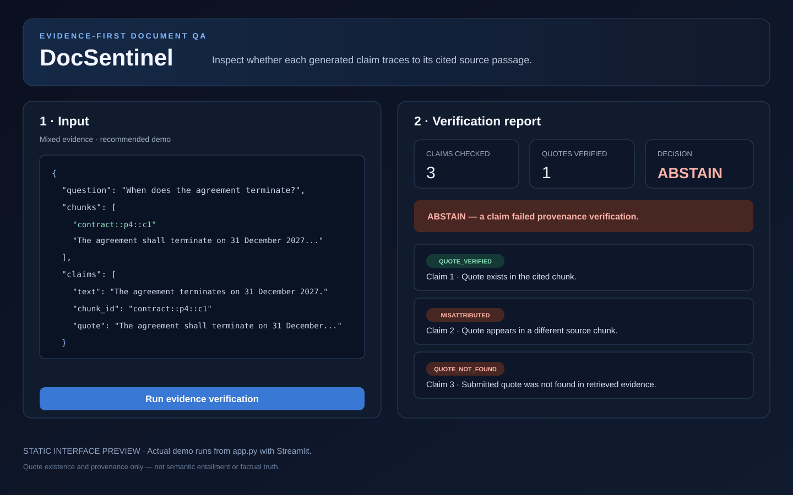

# DocSentinel

**Evidence-first document QA with an interactive citation-verification demo.**

DocSentinel is a research-oriented prototype for checking whether an AI-generated claim is traceable to the document evidence it cites. It combines a deterministic verification core with a small web interface for inspecting claim-level provenance decisions.

> **Current scope:** the verifier checks quote existence and source-chunk attribution (L1). It does **not** claim semantic entailment, factual truth, or end-to-end LLM QA.

## Interactive demo

Run the app locally:

\`\`\`bash
git clone https://github.com/whiterose456/Docsentinel.git
cd Docsentinel
python -m pip install -e .
python -m pip install -r requirements.txt
streamlit run app.py
\`\`\`

The app lets you:
- Load a clean, mixed, or adversarial example.
- Edit the structured JSON or upload your own JSON payload.
- Run quote and provenance checks.
- Inspect each claim's verdict and the source chunk involved.
- View the machine-readable audit report.

### Publish a live demo

The app is compatible with Streamlit Community Cloud:
1. Push this repository to GitHub.
2. Open [share.streamlit.io](https://share.streamlit.io/).
3. Create an app from this repository, choose branch **main**, and set the main file to **app.py**.
4. Set the Python version to 3.10 or newer if prompted.

No API key is required. The demo is deterministic and runs locally; deployment is a separate step and requires you to publish the app through your Streamlit account.

## Why DocSentinel?

A citation can look convincing while pointing to the wrong passage—or to text that does not exist. DocSentinel makes the first part of that problem testable:

1. Require each claim to include a source chunk ID and a verbatim quote.
2. Normalize harmless text-format differences.
3. Check whether the quote occurs in the cited chunk.
4. If not, search the rest of the retrieved evidence to detect misattribution.
5. Abstain when evidence provenance cannot be established.

The key distinction: **quote existence is not the same as semantic support**. A quote can exist and still fail to support a claim. The current MVP reports **QUOTE_VERIFIED**, not **SUPPORTED**.

## Quickstart: CLI

Requires Python 3.10+.

\`\`\`bash
python -m pip install -e .
python -m docsentinel demo
python -m unittest discover -s tests -v
python -m docsentinel verify --input examples/verification_case.json
\`\`\`

## Current verdicts

| Verdict | Meaning |
|---|---|
| **QUOTE_VERIFIED** | Normalized quote exists in the cited chunk. Provenance is verified; semantic support is not. |
| **MISATTRIBUTED** | Quote is absent from the cited chunk but exists in another retrieved chunk. |
| **QUOTE_NOT_FOUND** | Quote cannot be found in any retrieved chunk. |
| **UNATTRIBUTED** | Claim has no usable quote or chunk ID. |

The decision layer abstains if there are no claims or any claim fails provenance verification. This is intentionally conservative.

## Architecture

\`\`\`text
Structured answer + retrieved chunks
                |
                v
        Input validation
                |
                v
   L1: normalized quote matching
       |                  |
       | cited chunk      | other retrieved chunk
       v                  v
 QUOTE_VERIFIED       MISATTRIBUTED
                          |
                 no match anywhere
                          v
                    QUOTE_NOT_FOUND
                |
                v
       Claim-level verdicts
                |
                v
     Answer / abstain decision
                |
                v
       JSON audit report
\`\`\`

## Prototype status

- [x] Deterministic quote-existence check
- [x] Wrong-chunk / misattribution detection
- [x] Explicit abstention decision
- [x] JSON CLI and reproducible demo
- [x] Unit tests for normalization and verdicts
- [x] Structured audit output
- [x] Interactive Streamlit inspection interface
- [x] User-supplied JSON payload support
- [ ] PDF ingestion with page and character-offset metadata
- [ ] Dense + BM25 hybrid retrieval
- [ ] LLM answer generation with structured output
- [ ] Semantic entailment verification
- [ ] Frozen evaluation set and baseline study

## What to evaluate next

A meaningful next experiment is to compare:
1. A conventional answer with ordinary citations.
2. A quote-required answer format.
3. Quote-required output plus DocSentinel's provenance gate.

Use a frozen set of documents and human-labelled claims. Report citation precision, unsupported-claim rate, false abstention, answer coverage, latency, and cost. Do not treat the bundled synthetic examples as a benchmark.

## Important limitations

- A matching quote proves only that the text exists in the cited chunk.
- It does not prove entailment, factual truth, causality, or that a model relied on the quote.
- No LLM, retriever, PDF parser, or semantic NLI model is included in this iteration.
- Results are corpus-bounded: source documents themselves may be incorrect.
- Normalization is designed primarily for English/Latin-script text.

## Project positioning

DocSentinel is an experimental reliability layer for document-grounded AI—not a production legal, financial, or medical advice system. The immediate research question is whether auditable claim-level provenance checks, followed by calibrated semantic verification, can reduce unsupported answers at an acceptable coverage and latency cost.

## License

MIT. Dataset and model licenses must be checked separately before redistribution.
