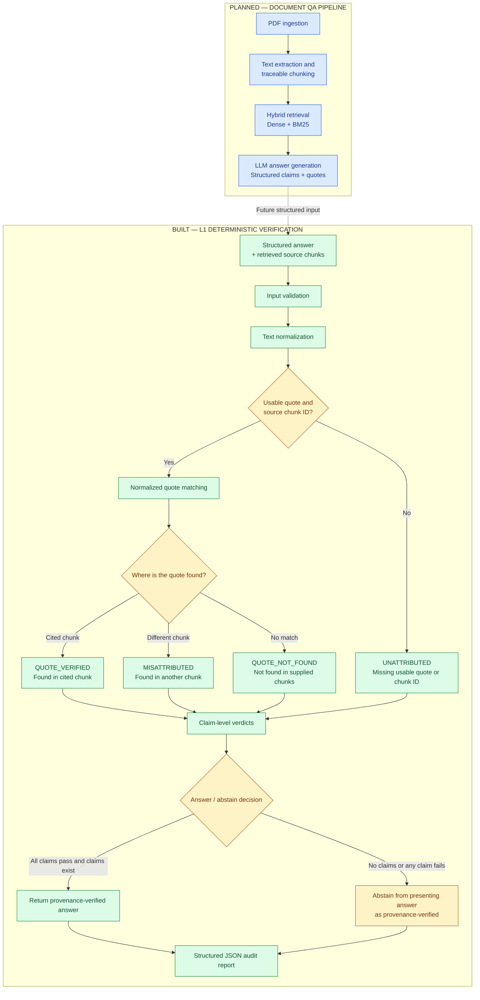

# DocSentinel — System Architecture

## 1. Overview

DocSentinel is an evidence-first document QA reliability prototype. Its current implementation is a deterministic **L1 provenance-verification pipeline**: it checks whether a supplied quotation exists in the retrieved source chunks and whether it appears in the chunk identified by the claim.

The current system does **not** assess semantic entailment, factual truth, or whether a generated model answer logically follows from its evidence. A `QUOTE_VERIFIED` result means that quotation provenance was verified; it does not mean that the claim was semantically supported.

This document separates the implemented MVP from planned architecture extensions.

## 2. Architecture Diagram

Green nodes represent current implementation. Blue nodes represent planned work. The dashed connection indicates the intended future integration: an upstream ingestion/retrieval/generation pipeline will provide structured answers and retrieved chunks to the existing verification core.

## 3. Current L1 Processing Flow

### 3.1 Inputs

The verifier receives two primary inputs:

- **Structured answer:** Claims with their supplied quotations and source chunk identifiers.
- **Retrieved source chunks:** The text chunks against which quotations are checked.

The current verifier consumes these inputs; it does not itself perform PDF ingestion, retrieval, or LLM generation.

### 3.2 Input Validation

The system validates the structured payload before attempting verification. Claims without a usable quotation or source chunk identifier are classified as `UNATTRIBUTED`.

### 3.3 Text Normalization

Text normalization is applied before comparison to reduce irrelevant formatting differences. Normalization supports more consistent matching, but it does not establish semantic equivalence between differently worded passages.

### 3.4 Deterministic Quote Matching

For each attributable claim, the verifier checks the normalized quotation against the cited source chunk and the other supplied retrieved chunks.

The matching outcome determines the verdict:

1. If the quote is found in the cited chunk, return `QUOTE_VERIFIED`.
2. If it is absent from the cited chunk but found in another supplied chunk, return `MISATTRIBUTED`.
3. If it is not found in any supplied chunk, return `QUOTE_NOT_FOUND`.

A missing usable quotation or source chunk ID results in `UNATTRIBUTED`.

## 4. Verdict Definitions

| Verdict | Deterministic condition | What it establishes |
|---|---|---|
| `QUOTE_VERIFIED` | Normalized quote exists in the cited chunk | Quote provenance matches the supplied source reference |
| `MISATTRIBUTED` | Quote is absent from the cited chunk but exists in another retrieved chunk | The quote exists, but the supplied attribution is wrong |
| `QUOTE_NOT_FOUND` | Quote is absent from all supplied retrieved chunks | The supplied evidence does not contain the quotation |
| `UNATTRIBUTED` | Claim has no usable quote or chunk ID | The claim cannot be checked against an identified source |

These are provenance verdicts, not semantic-support verdicts. In particular, `QUOTE_VERIFIED` must not be relabelled as “supported” or “factually correct.”

## 5. Claim-Level Aggregation and Abstention

After individual claims are checked, the system collects their verdicts into a claim-level result.

The current decision layer follows a conservative provenance policy:

- If there are no claims, abstain.
- If any claim fails provenance verification, abstain from presenting the answer as provenance-verified.
- If claims exist and all claims pass provenance verification, the answer can pass the provenance gate.

The audit output retains the verification results so that individual claim outcomes remain inspectable.

**Scope clarification:** This gate checks provenance only. It cannot guarantee that a quote entails its claim, that the document is correct, or that the overall answer is true. Semantic entailment verification is a planned extension.

## 6. JSON Audit Report

The verification workflow produces structured JSON audit output. The audit report is the machine-readable record of the verification results and decision.

It supports inspection and reproducibility by exposing claim-level outcomes and the overall provenance decision. The exact report fields are defined by the implementation and should remain aligned with the code as it evolves.

## 7. Implemented Interfaces and Tests

The current repository includes:

- A command-line interface for running verification.
- Example JSON payloads for clean, mixed, and adversarial cases.
- Unit tests covering normalization and verdict behavior.
- A Streamlit interface for editing or uploading a JSON payload, running verification, and inspecting claim-level verdicts, source chunks, and the audit report.

These interfaces exercise the deterministic verification core; they do not imply that an LLM or retrieval system is already integrated.

## 8. Planned Architecture Extensions

The following components are roadmap items, not part of the current MVP.

### 8.1 PDF Ingestion and Traceable Chunking

Add PDF text extraction and chunking. Preserve document identifiers and, where available, page numbers and character offsets so retrieved evidence can be traced back to its source location.

### 8.2 Hybrid Retrieval

Add dense vector retrieval and BM25 lexical retrieval. Combine their results into a hybrid evidence set while preserving chunk identifiers and source metadata.

Evaluate retrieval independently before relying on it for answer generation.

### 8.3 LLM Answer Generation

Provide retrieved chunks to an LLM and request structured claim-level output containing source chunk IDs and verbatim quotations. Pass that output through the existing L1 verifier.

The L1 gate remains useful as a deterministic provenance check even when answers are generated by an LLM.

### 8.4 Semantic Entailment Verification

Add a semantic verification component to assess the relationship between each claim and its cited evidence. The future verifier should distinguish:

- Supporting evidence.
- Contradictory evidence.
- Insufficient evidence.

Semantic verification complements, rather than replaces, quote-existence and attribution checks. The combined system can then make a more informed answer/abstention decision.

## 9. Design Principles

1. **Evidence-first:** Claims should be traceable to supplied source material.
2. **Deterministic core:** Quote matching and attribution checks should remain independently testable.
3. **Separation of concerns:** Validation, normalization, matching, decision-making, and reporting have distinct responsibilities.
4. **Explicit uncertainty:** Missing provenance must not be silently treated as verified.
5. **Preserved provenance:** Source chunk identifiers should remain attached to evidence throughout the pipeline.
6. **Incremental extension:** Retrieval and semantic verification should extend the existing core without overstating what L1 establishes.

## 10. Summary

The current DocSentinel MVP implements deterministic L1 checks for quotation existence and source-chunk attribution, followed by claim-level reporting, a conservative abstention gate, and JSON audit output.

The roadmap adds PDF ingestion, hybrid retrieval, structured LLM answer generation, and semantic entailment verification. This progression preserves a clear distinction between verifying that evidence exists in the cited location and evaluating whether that evidence actually supports a claim.
